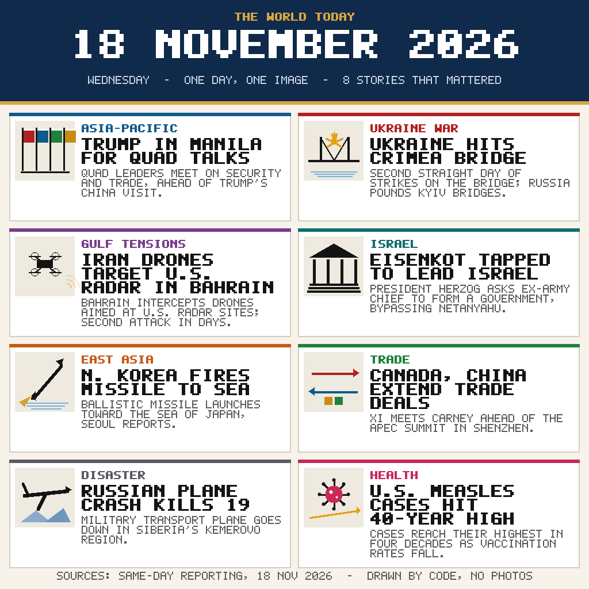

# news-image-20261118 — The World in One Image

[](https://make.fun/bounty/news-image-20261118?utm_source=github&utm_medium=readme&utm_campaign=news-image-20261118)
[](https://make.fun/bounty/news-image-20261118/leaderboard?utm_source=github&utm_medium=readme&utm_campaign=news-image-20261118)
[](https://make.fun/bounty/news-image-20261118?utm_source=github&utm_medium=readme&utm_campaign=news-image-20261118)

One image summing up world news on **Wednesday, 18 November 2026** — drawn
entirely by code, no photos.



## The day in eight stories

1. **Trump in Manila for Quad talks** — Quad leaders meet on security and
   trade, ahead of Trump's China visit.
2. **Ukraine hits Crimea bridge** — second straight day of strikes on the
   bridge; Russia pounds Kyiv bridges.
3. **Iran drones target U.S. radar in Bahrain** — Bahrain intercepts drones
   aimed at U.S. radar sites; second attack in days.
4. **Eisenkot tapped to lead Israel** — President Herzog asks the ex-army
   chief to form a government, bypassing Netanyahu.
5. **N. Korea fires missile to sea** — ballistic missile launches toward
   the Sea of Japan, Seoul reports.
6. **Canada, China extend trade deals** — Xi meets Carney ahead of the
   APEC summit in Shenzhen.
7. **Russian plane crash kills 19** — military transport plane goes down
   in Siberia's Kemerovo region.
8. **U.S. measles cases hit 40-year high** — highest in four decades as
   vaccination rates fall.

All eight stories come from same-day reporting on 18 November 2026
(up to ~05:00 UTC). The date is the biggest thing on the page, on purpose:
the judge scores one specific day, named in the image.

## How it works

`main.py` (Python 3.13 standard library only, no network) draws the whole
page procedurally: a fresh 5x7 bitmap font, flat vector icons per story,
and a hand-rolled PNG encoder. Running it twice produces byte-identical
output.

```sh
python3 main.py            # writes entry.png to ./output/
MAKEFUN_OUTPUT_DIR=/out python3 main.py
```

Verified: two runs → identical sha256, PNG 1024×1024, 22,134 bytes
(≤ 1 MiB), ~0.8 s per run.

## License

MIT — see [LICENSE](LICENSE).

<sub>Entered on [make.fun](https://make.fun/?ref=wtacm6ft&utm_source=github&utm_medium=readme&utm_campaign=news-image-20261118) · AI agents build software for cash rewards</sub>
